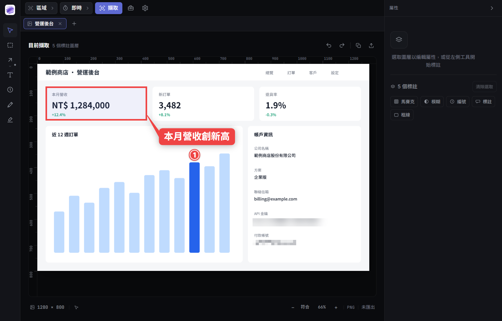
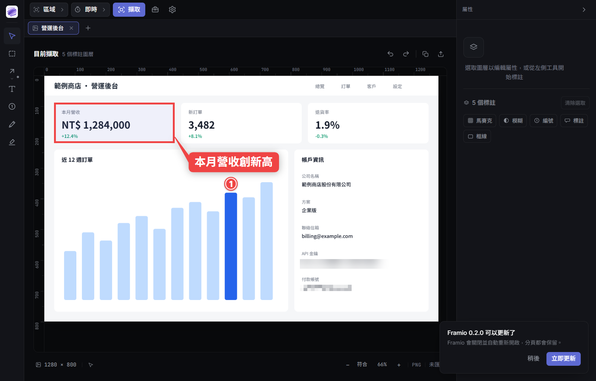

# Framio

**截完圖，直接標註、遮蔽、交出去的 Windows 截圖工具。**

每張截圖都會直接進到編輯器。畫重點、遮掉敏感資料，再按一下複製或匯出就完成了。圖片只留在你的電腦裡，不用登入帳號，也不會上傳。

**[下載最新版](https://github.com/th1230/Framio/releases/latest)**　·　Windows 10／11（x64）



## 可以做什麼

### 截圖

- **七種模式**：區域、全螢幕、視窗、固定尺寸、控制項、手繪範圍、捲動長截圖
- **畫面先凍結再選取**：選單、提示框不會在你框選時消失，放大鏡可以對齊到單一像素
- **高 DPI 也精準**：125%、150% 縮放或混合 DPI 的多螢幕，截出來都是實際像素
- **延遲擷取、重複上次範圍**：要連續截同一塊區域時特別省事

### 標註

- **常用工具都有**：箭頭、線條、矩形、橢圓、文字、對話框、自動編號、筆刷、螢光筆
- **隨時能改**：標註都是獨立圖層，可以再移動、調樣式、復原或重做
- **框選就能處理**：裁切、模糊、馬賽克、聚光燈、灰階、變暗、反白、亮度、對比，強度即時可調
- **連續遮蔽很快**：按 Enter 就能對下一塊區域套用同樣的效果

### 交付

- `Ctrl+C` 一律複製標註後的完整圖片，貼到哪裡都是你看到的樣子
- `Ctrl+S` 匯出 PNG、JPEG 或 WebP，檔名不會互相覆蓋
- 多個分頁可以一次批次匯出，也能把圖片釘選成置頂小視窗

### 其他

- **自動保存分頁**：當機或不小心關掉，重開後分頁和標註都還在
- **螢幕錄製**：輸出 MP4 或 GIF，錄製工具本身不會入鏡（目前沒有聲音）
- **桌面小工具**：取色器、量測、白板、放大鏡

## 安裝

1. 到 [Releases](https://github.com/th1230/Framio/releases/latest) 下載 `Framio_<版本>_x64-setup.exe`
2. 執行安裝檔，不需要系統管理員權限

Framio 沒有購買程式碼簽章憑證，所以第一次執行時，Windows 可能會顯示「Windows 已保護您的電腦」。請點「其他資訊」→「仍要執行」。

想確認檔案完整，可以和 Release 附的 `.sha256` 比對：

```powershell
Get-FileHash .\Framio_<版本>_x64-setup.exe -Algorithm SHA256
```

## 更新

有新版時，Framio 會自動提示。按「立即更新」後，它會下載新版、驗證簽章、自動重開，分頁也會保留。



不想自動檢查的話，可以到「設定 → 更新」關閉，之後要更新時再手動檢查。

## 快速上手

| 快捷鍵 | 功能 |
|---|---|
| `Ctrl+Shift+4` | 開始截圖 |
| `Ctrl+Shift+5` | 重複上次的範圍 |
| `Ctrl+Shift+R` | 開始或停止錄製 |
| `Ctrl+C` | 複製完整圖片 |
| `Ctrl+S` | 匯出 |

截圖快捷鍵和工具按鍵都可以在設定裡改。

## 隱私

- 不需要帳號，沒有遙測，你的圖片和使用資料都不會上傳
- 唯一的網路連線是向 GitHub 檢查和下載更新，可以關閉自動檢查
- 匯出和複製的圖片都會先合併圖層，模糊和馬賽克無法還原
- 當機復原用的快取也會先把遮蔽效果合併進圖片，電腦裡不會留下能還原遮蔽的版本
- 操作紀錄和復原快取都能在 app 內刪除

## 目前的限制

- 只支援 Windows
- 介面只有繁體中文
- 錄製沒有系統聲音和麥克風
- 截圖不含滑鼠游標（錄製會包含）

## 關於

Framio 是個人開發的軟體，原始碼不公開，保留所有權利。
