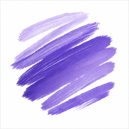
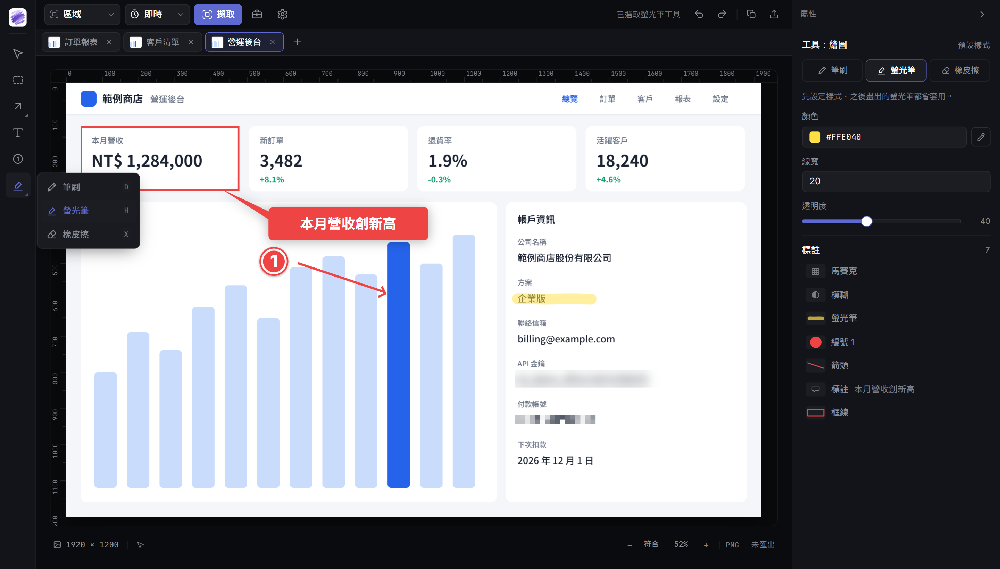
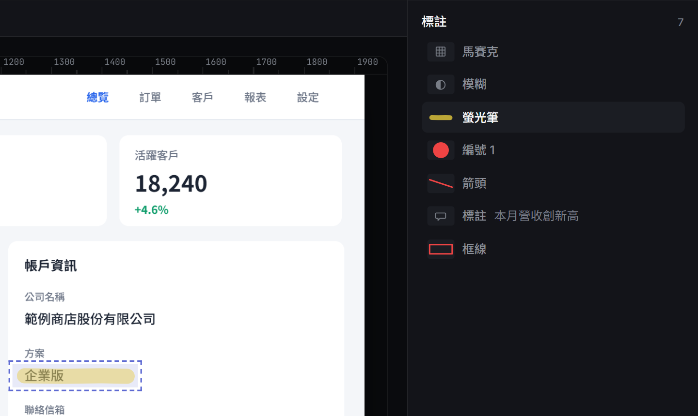
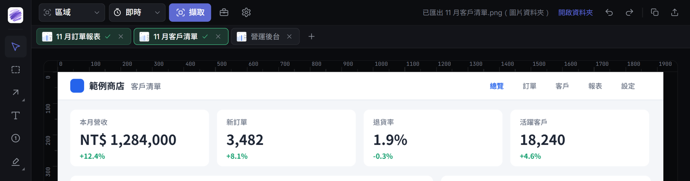

<div align="center">



# Framio

**為 Windows 打造的截圖與標註工具**

截圖、標重點、遮蔽敏感資料，幾個按鍵就能交出去。

全程在本機處理，不需要帳號，圖片也不會上傳。

[](https://github.com/th1230/Framio/releases/latest)
-5E6AD2)

### [下載最新版](https://github.com/th1230/Framio/releases/latest)

</div>


<p align="center"><sub>畫面中的公司與資料皆為示範用途。</sub></p>

## 功能特色

### 精準擷取

提供七種模式：區域、全螢幕、視窗、固定尺寸、控制項、手繪範圍與捲動長截圖。

- **先凍結再選取**：選單和提示框不會在框選時消失，放大鏡可以對齊到單一像素
- **自動辨識區塊**：視窗模式會認出網頁內容、開發者工具等區塊，滾輪可以切換到整個視窗
- **高 DPI 不失真**：125%、150% 縮放與混合 DPI 的多螢幕環境，都以實際像素輸出
- **延遲與重複擷取**：可以延遲幾秒再截，也能一鍵重複上次的範圍

### 完整標註

箭頭、直線、框線、橢圓、文字、標註框、自動編號、筆刷、螢光筆與橡皮擦，常用工具都有。每個標註都是獨立圖層，之後可以再移動、改樣式或復原。



右側清單列出所有標註。滑鼠停在任一列，畫布上就會標出對應的位置，標註一多也找得到。

<p align="center">
  
</p>

### 遮蔽敏感資料

框選範圍後可以套用模糊、馬賽克、聚光燈、灰階、變暗、反白、亮度與對比，強度即時可調。要連續遮蔽多個欄位時，按 `Enter` 就能對下一塊範圍套用同樣的效果。

匯出和複製時都會先合併圖層，遮蔽效果無法從輸出的圖片還原。

### 快速交付

- **複製**：`Ctrl+C` 一律複製標註後的完整圖片，貼到哪裡都和畫面一致
- **匯出**：`Ctrl+S` 輸出 PNG、JPEG 或 WebP，可以直接命名，已存在的檔案不會被覆蓋
- **多張處理**：一次開多個分頁，用 `Ctrl`、`Shift` 或 `Ctrl+A` 多選後批次匯出
- **進度清楚**：匯出過的分頁會標成綠色，還沒處理的一眼就看得出來



### 其他工具

- **自動保存**：當機或誤關後重新開啟，分頁和標註都還在
- **螢幕錄製**：輸出 MP4 或 GIF，錄製工具本身不會入鏡
- **桌面小工具**：取色器、量測、白板、放大鏡，也能把圖片釘選成置頂小視窗
- **背景待命**：開機後在背景待命，快捷鍵隨時可用；不需要時可以在設定裡關閉

## 安裝

**系統需求**：Windows 10 或 Windows 11（x64）。

1. 到 [Releases](https://github.com/th1230/Framio/releases/latest) 下載 `Framio_<版本>_x64-setup.exe`
2. 執行安裝檔，不需要系統管理員權限

Framio 目前沒有程式碼簽章憑證，第一次執行時 Windows 可能會顯示「Windows 已保護您的電腦」。請點「其他資訊」，再點「仍要執行」。

如果想確認下載的檔案完整，可以和 Release 附的 `.sha256` 比對：

```powershell
Get-FileHash .\Framio_<版本>_x64-setup.exe -Algorithm SHA256
```

## 自動更新

有新版時，Framio 會在右下角提示。按下「立即更新」後會下載新版、驗證更新簽章並自動重開，分頁也會保留。

<p align="center">
  
</p>

不想自動檢查的話，可以到「設定 → 更新」關閉，之後再手動檢查。

## 快捷鍵

| 全域 | 功能 |
|---|---|
| `Ctrl+Shift+4` | 開始截圖 |
| `Ctrl+Shift+5` | 重複上次的範圍 |
| `Ctrl+Shift+R` | 開始或停止錄製 |

| 編輯器 | 功能 |
|---|---|
| `Ctrl+C` | 複製完整圖片 |
| `Ctrl+S` | 匯出 |
| `Ctrl+Tab` | 切換分頁 |
| `F2` | 重新命名分頁（焦點在分頁上時） |

| 工具 | 按鍵 | 工具 | 按鍵 |
|---|---|---|---|
| 游標 | `V` | 文字 | `T` |
| 選取範圍 | `M` | 標註 | `Q` |
| 箭頭 | `A` | 編號 | `N` |
| 直線 | `L` | 筆刷 | `D` |
| 框線 | `R` | 螢光筆 | `H` |
| 橢圓 | `E` | 橡皮擦 | `X` |

截圖快捷鍵和工具按鍵都可以在設定裡更改。如果按鍵已被其他程式佔用，Framio 會提示你換一組。

## 隱私

- **不需要帳號**：沒有遙測，圖片和使用資料都不會上傳
- **網路連線**：只有檢查與下載更新時會連到 GitHub，自動檢查可以關閉
- **本機快取**：當機復原用的快取會先合併遮蔽效果，電腦裡不會留下可以還原遮蔽的版本
- **可自行清除**：操作紀錄和復原快取都能在 app 內刪除

## 目前限制

- 僅支援 Windows
- 介面僅提供繁體中文
- 錄製不含系統聲音與麥克風
- 截圖不含滑鼠游標（錄製會包含）

## 關於

Framio 由個人開發，原始碼不公開，保留所有權利。
